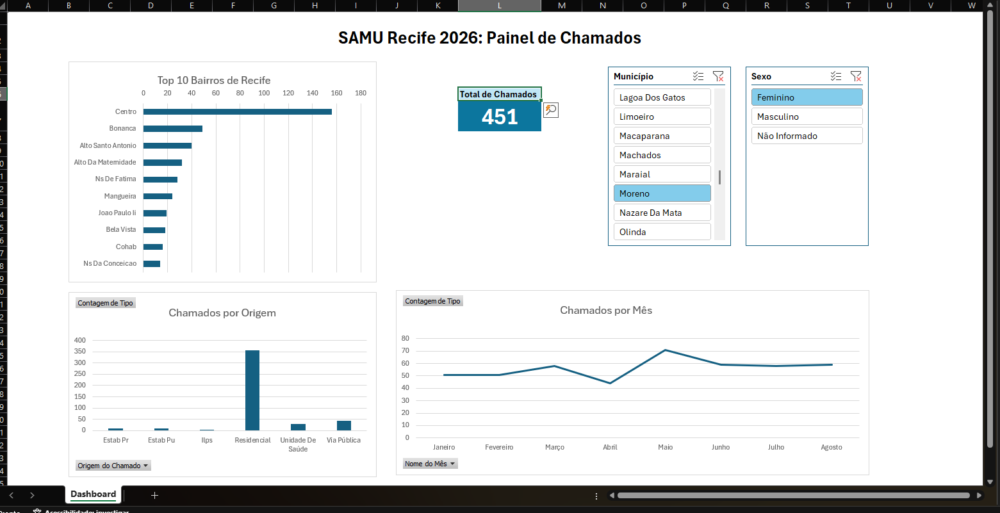

# Dashboard SAMU Recife 2026

Dashboard interativo em Excel sobre os chamados do SAMU no Recife e região metropolitana, de janeiro a agosto de 2026.

## Fonte dos dados
Portal de Dados Abertos da Prefeitura do Recife: [SAMU 2026](https://dados.recife.pe.gov.br/dataset/servico-de-atendimento-movel-de-urgencia-samu-2026)

## O que foi feito
- **Limpeza (Power Query):** tipos de dados, padronização de textos, tratamento de vazios, zeros e idades inválidas, remoção de colunas sensíveis (endereço)
- **Modelagem (Power Pivot):** tabela fato e tabelas de apoio (origem, bairro e calendário) com relacionamentos
- **Dashboard:** gráficos dinâmicos, segmentações de dados (Município e Sexo) e medida DAX de total de chamados

## Alguns achados
- Base com 129.624 chamados no período
- A maioria dos chamados vem de residências
- Boa Viagem é o bairro com mais chamados no Recife
- O nome "Centro" se repete em vários municípios, então a análise por bairro deve ser filtrada por município

## Ferramentas
Excel, Power Query, Power Pivot e DAX

*Print com o filtro de município em Recife (50.357 chamados). A base completa tem 129.624 chamados.*
